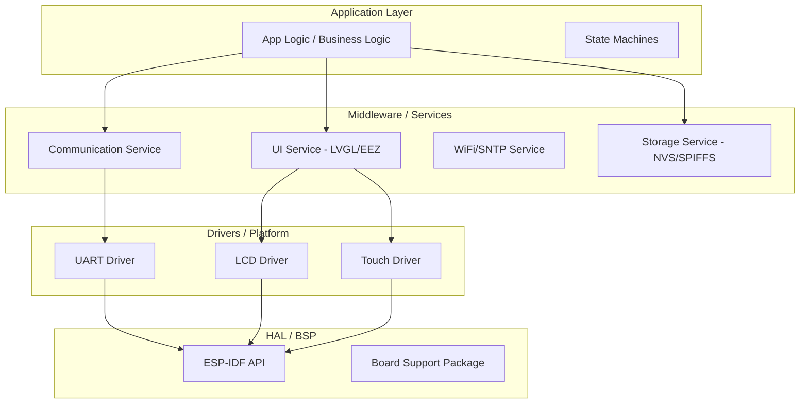

# Raport Architektury Oprogramowania: ESP32-S3-JC8048W550

## 1. Analiza obecnej architektury

Obecna architektura projektu jest typowa dla systemów ewoluujących z prototypu w stronę produktu. Wykorzystuje potężne frameworki (ESP-IDF, LVGL, EEZ Flow), ale wykazuje oznaki "Big Ball of Mud" w warstwie logicznej.

### Struktura katalogów
*   `main/hal`: Abstrakcja sprzętu (LCD, Touch). Dobry kierunek, ale silnie powiązany z konkretnym modelem Sunton.
*   `main/communication`: Serce systemu. Obsługuje UART, COBS, logikę biznesową i mapowanie UI.
*   `main/app`: Punkt wejścia i główna pętla logiczna.
*   `main/ui`: Kod wygenerowany przez EEZ Studio.

### Główne problemy
1.  **Nadmierny Coupling (Sprzężenie):** Moduł `CommunicationProtocol` odpowiada za zbyt wiele rzeczy: parsowanie ramek, zarządzanie stanem połączenia, przechowywanie danych oraz bezpośrednie aktualizowanie widgetów LVGL/EEZ.
2.  **Globalny Stan:** Logika opiera się na statycznych zmiennych wewnątrz namespaców i "dirty flags". Utrudnia to testowanie jednostkowe (unit testing) i śledzenie przepływu danych.
3.  **Zależności UI w logice:** Pliki takie jak `CommUiMapper.cpp` odwołują się bezpośrednio do obiektów LVGL (`objects.settings_melody_dropdown`). Jeśli nazwa obiektu w EEZ Studio zostanie zmieniona, kod C++ przestanie się kompilować.
4.  **Brak abstrakcji komunikacji:** Protokół jest sztywno związany z UART. Dodanie innego medium (np. BLE czy TCP) wymagałoby przepisania dużej części `CommunicationProtocol`.

---

## 2. Idealna Architektura Firmware (Docelowa)

Proponuję przejście na architekturę warstwową (Layered Architecture) z wyraźną separacją odpowiedzialności.

### Diagram Architektury



### Podział warstw
1.  **HAL / BSP**: Najniższa warstwa. Tutaj definiujemy piny i podstawowe inicjalizacje. Kod tutaj nie powinien wiedzieć o istnieniu LVGL czy protokołu komunikacyjnego.
2.  **Drivers**: Obiekty/Moduły zarządzające konkretnym peryferium (np. `DisplayDevice`, `UartTransport`). Powinny implementować interfejsy.
3.  **Services**: Warstwa orkiestracji. Np. `WeatherService` zbiera dane z komunikacji i powiadamia UI.
4.  **Application Layer**: Logika wysokopoziomowa. Tu podejmujemy decyzje: "jeśli temperatura > 30, zmień kolor tła na czerwony".

---

## 3. Refaktoryzacja Kodu

### Przykład: Dependency Injection i Interfejsy

**Obecnie (Złe):**
`CommunicationProtocol` bezpośrednio woła `UartTransport`.

**Po refaktoryzacji (Dobre):**
Wprowadzamy interfejs `ITransport`.

```cpp
// ITransport.h
class ITransport {
public:
    virtual void send(const uint8_t* data, size_t len) = 0;
    virtual bool receive(uint8_t* buffer, size_t maxLen, size_t& receivedLen) = 0;
};

// CommunicationService.h
class CommunicationService {
    ITransport& _transport;
public:
    CommunicationService(ITransport& transport) : _transport(transport) {}
    void process() {
        // Logika protokołu niezależna od tego czy to UART czy WiFi
    }
};
```

### Przykład: Event-Driven UI (Zamiast Dirty Flags)

Zamiast sprawdzać `isDirty()` co 100ms, używamy wzorca Observer lub prostych callbacków.

**Before:**
```cpp
void updateUi() {
  if (isDirty()) {
    applySnapshotToMainScreen(getLocalSnapshot());
  }
}
```

**After:**
```cpp
// SnapshotManager.h
class SnapshotManager {
    using Callback = std::function<void(const Snapshot&)>;
    std::vector<Callback> _observers;
public:
    void updateSnapshot(const Snapshot& s) {
        _current = s;
        for(auto& cb : _observers) cb(s);
    }
};
```

---

## 4. Zarządzanie Pamięcią

W systemie z LVGL i ESP32-S3 pamięć jest krytycznym zasobem.

### Strategia Pamięci
1.  **PSRAM (External RAM)**:
    *   **Framebufery**: MUSZĄ być w PSRAM (2 x 800x480x2 bajty = ~1.5 MB).
    *   **Duże bufory**: Bufory dla obrazów dekompresowanych w locie.
2.  **SRAM (Internal RAM)**:
    *   **Kolejki FreeRTOS**: Dla stabilności powinny być w SRAM.
    *   **Stosy zadań (Task Stacks)**: Szczególnie zadania obsługujące TLS/WiFi potrzebują ~8KB+.
3.  **DMA Memory**:
    *   Wymagana dla transferów LCD i UART (jeśli używamy buforów > 4KB). Musi być alokowana z flagą `MALLOC_CAP_DMA` i często `MALLOC_CAP_INTERNAL`.

### Zapobieganie Fragmentacji
*   **Static Allocation**: Dla stałych komponentów (np. instancje serwisów) używamy alokacji statycznej lub `MALLOC_CAP_INTERNAL` na starcie.
*   **Memory Pools**: Dla obiektów o stałym rozmiarze (np. ramki komunikacyjne).
*   **Zero-copy**: Przy odbiorze danych z UART, parsujemy dane bezpośrednio w buforze odbiorczym zamiast kopiować je do nowej struktury `Snapshot` na każdym etapie.

---

## 5. Dobre praktyki produkcyjnego embedded

1.  **Watchdog Strategy**:
    *   Używamy `Task Watchdog` dla głównej pętli LVGL.
    *   **Krytyczne**: Fix `lv_textarea` (już zaimplementowany) jest przykładem walki z blokowaniem watchdoga przez O(N²) operacje.
2.  **Fault Recovery**:
    *   I2C bus recovery (jeśli Touch przestanie odpowiadać, system powinien zresetować szynę I2C bez restartu całego ESP).
    *   Komunikacja: Jeśli peer (Zegar) nie odpowiada przez 30s, resetujemy stan maszyny stanów handshaku.
3.  **Logging**:
    *   Używanie poziomów `ESP_LOGD` (debug) i `ESP_LOGV` (verbose) dla komunikacji, aby nie zalewać konsoli w produkcji, ale móc łatwo diagnozować błędy.
4.  **Thread Safety**:
    *   Wszelkie operacje na LVGL z innych zadań MUSZĄ być otoczone `lvgl_port_lock()` / `lvgl_port_unlock()`.

---

## 6. Standard jakości kodu

*   **Naming**: Przejście na standard PascalCase dla klas i camelCase dla metod.
*   **API Consistency**: Metody `begin()` powinny zwracać `esp_err_t`, aby móc reagować na błędy inicjalizacji sprzętu.
*   **Unit Tests**: Przez odseparowanie logiki komunikacji od `UartTransport`, możemy przetestować parser ramek na komputerze PC (Host-based testing).

---

## 7. Wynik końcowy - Checklista Refaktoryzacji

### Priorytety (Quick Wins)
- [ ] **Odseparowanie UI Mapper**: Przeniesienie `CommUiMapper.cpp` do warstwy UI, aby `CommunicationProtocol` tylko udostępniał dane (Getters/Signals).
- [ ] **Enkapsulacja stanu**: Zamiana globalnych zmiennych w `CommunicationState.cpp` na klasę singleton lub obiekt przekazywany przez DI.

### High-Risk Areas
- **PSRAM Contention**: Dwa bufory LCD konkurują o szynę z dostępem do zmiennych UI. Monitorować wydajność przy animacjach.
- **UART Overrun**: Przy dużej ilości danych z sensora, bufor UART może się przepełnić. Wymagana obsługa w osobnym zadaniu o wysokim priorytecie.

### Rekomendacje długoterminowe
1.  **Implementacja Maszyna Stanów (FSM)**: Dla handshaku komunikacji użyć sformalizowanej maszyny stanów (np. wzorzec State), zamiast dużego `switch-case`.
2.  **Hardware Abstraction Layer**: Stworzenie czystego interfejsu dla wyświetlacza, aby móc łatwo przenieść projekt na inny moduł ESP32-S3 (np. z innym kontrolerem LCD).

---

*Raport przygotowany przez: Antigravity AI*
