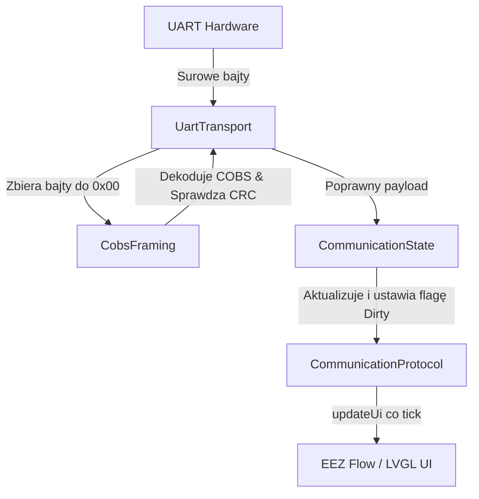
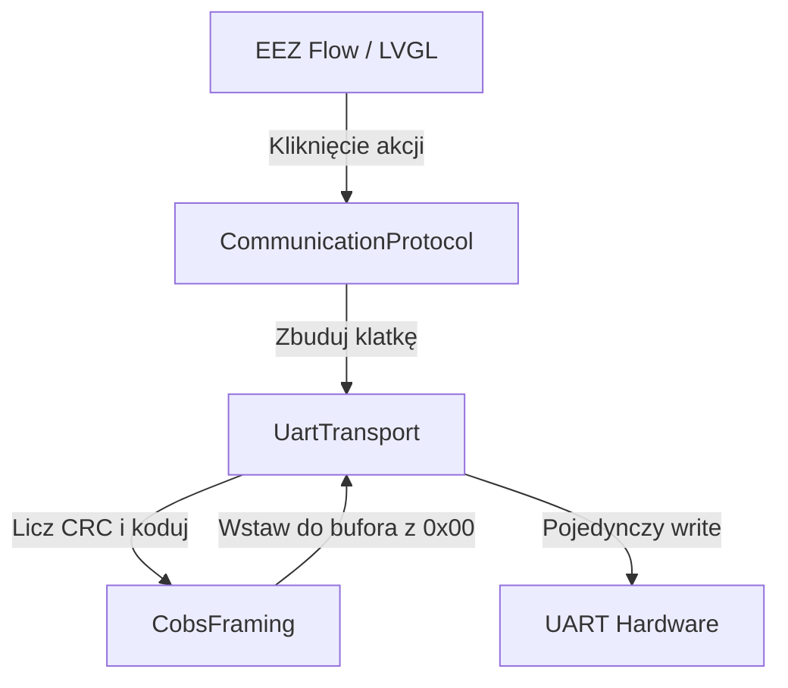

# Architektura Modułu Komunikacji (Communication)

Ten katalog zawiera implementację dwukierunkowej komunikacji UART między ekranem Guition (ESP32-S3) a głównym procesorem ZEGAR-ESP32, opartej na protokole klatkowania COBS.

Wszystkie odpowiedzialności zostały rozdzielone na 4 dedykowane pliki źródłowe (Single Responsibility Principle), co ułatwia testowanie i rozwój.

---

## Przegląd Plików

### 1. `CobsFraming.h` / `CobsFraming.cpp`
**Odpowiedzialność**: Czysta logika klatkowania oraz weryfikacji sum kontrolnych.
- Zawiera implementacje algorytmów `cobsEncode` i `cobsDecode`.
- Oblicza sumy kontrolne poprzez `crc16Ccitt`.
- Nie posiada żadnej wiedzy o FreeRTOS, UART czy logice UI.

### 2. `CommunicationState.h` / `CommunicationState.cpp`
**Odpowiedzialność**: Magazyn danych urządzenia i ich ochrona wątkowa.
- Przechowuje struktury `Snapshot` oraz `DeviceSettings` (poprzez dołączenie `CommunicationProtocol.h`).
- Zapewnia bezpieczny dostęp do tych struktur za pomocą wewnętrznego mutexa (`lockSnapshot()`, `unlockSnapshot()`).
- Odpowiada za interpretację i parsowanie danych z surowych bajtów payloadu na struktury (`applyWeatherPayload`, `applyPmsPayload`, itd.).

### 3. `UartTransport.h` / `UartTransport.cpp`
**Odpowiedzialność**: Warstwa transportowa i komunikacja sprzętowa.
- Konfiguruje parametry UART-u mikrokontrolera (`beginUart()`).
- Uruchamia dedykowane zadanie FreeRTOS (`communicationTask`), które cyklicznie odczytuje dane z portu UART i przekazuje je do parsera COBS.
- Składa gotowe ramki (dodaje nagłówek, oblicza CRC, koduje COBS) i wysyła je atomowo na port szeregowy (`sendRawFrame()`).

### 4. `CommunicationProtocol.h` / `CommunicationProtocol.cpp`
**Odpowiedzialność**: Publiczna Fasada (Facade Pattern) oraz integracja z interfejsem graficznym.
- Stanowi główny punkt styku dla reszty aplikacji.
- Zawiera funkcję `updateUi()`, która pobiera najnowszy stan z magazynu danych i cyklicznie aktualizuje zmienne EEZ Flow/LVGL.
- Przechowuje akcje przycisków (`action_toggle_buzzer()`, itd.) wywoływane z poziomu interfejsu EEZ Flow.

---

## Przepływ Danych (Data Flow)

### Odbiór danych (Od ZEGAR-ESP32 do Guition)

### Wysyłanie danych (Od Guition do ZEGAR-ESP32)

